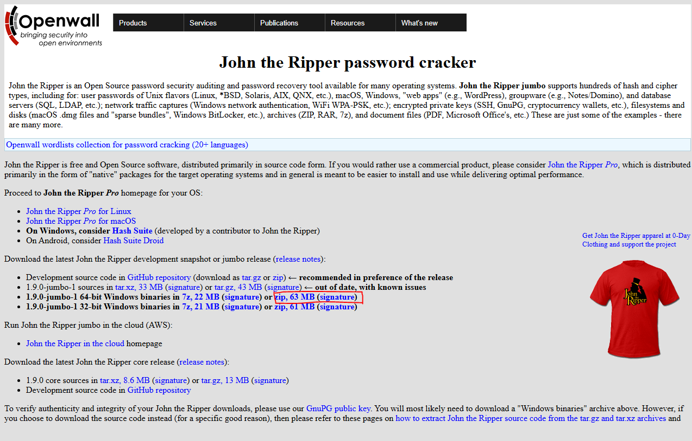
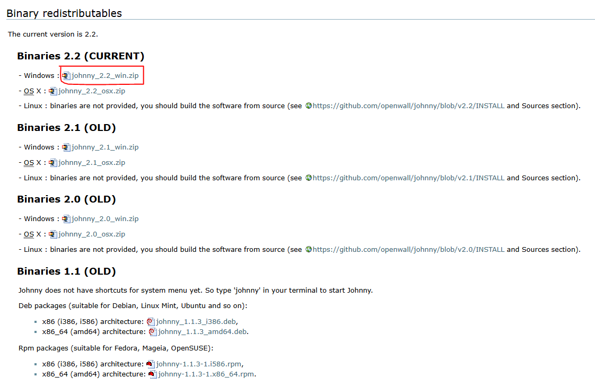
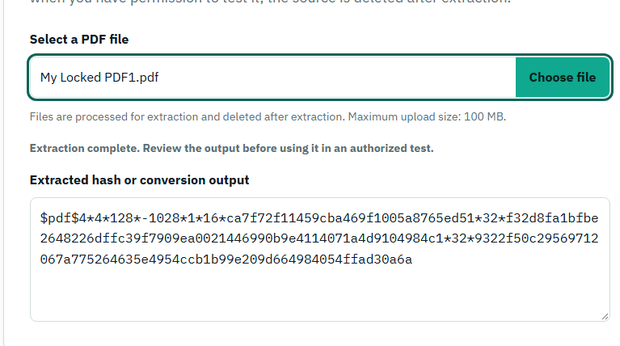
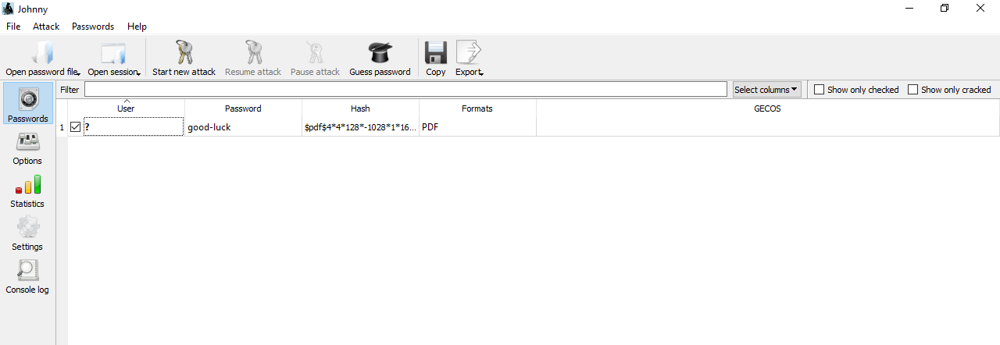
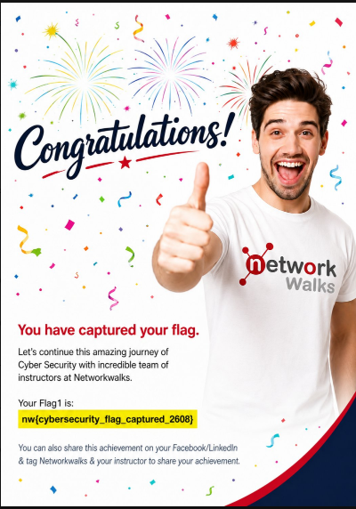
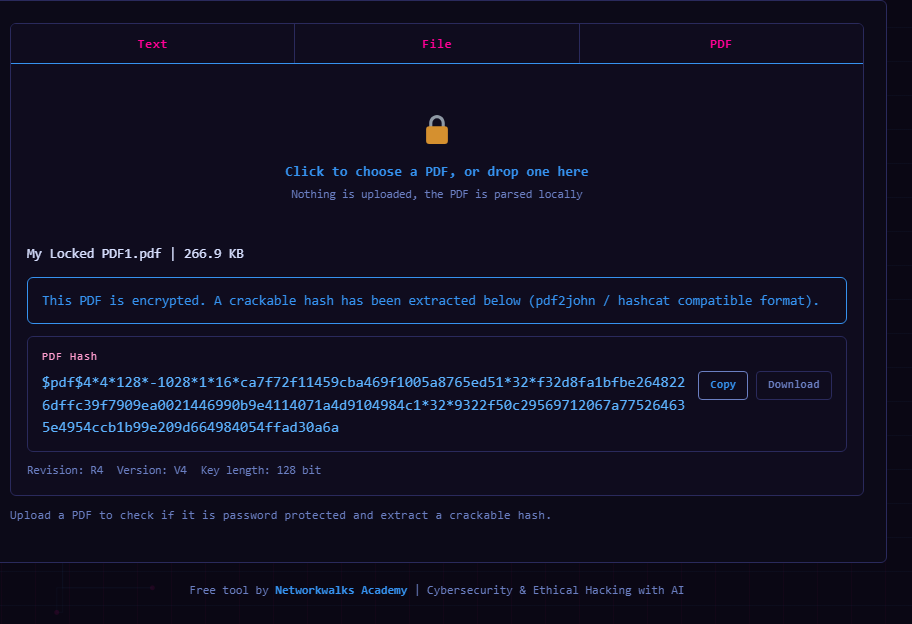
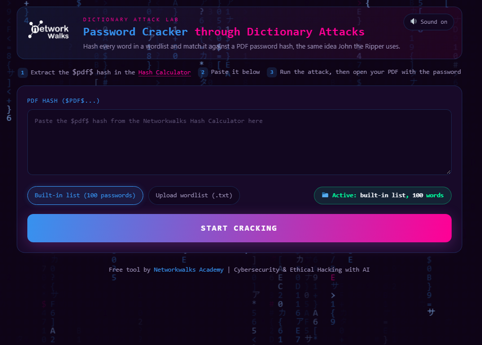
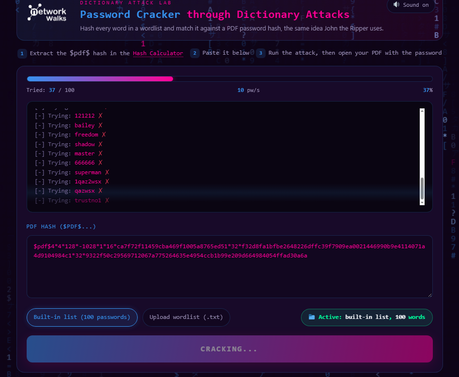

# 🔓 Password Cracking with John The Ripper & NetworkWalks Tools

### Cracking the password of a locked file using hash extraction and wordlist attack in an isolated lab

## ⚠️ Disclaimer / Ethical Note

> This project was created *only for study and learning purposes* as part of my Cyber Security Internship at NetworkWalks.
>
> All activities were performed in an *isolated lab environment* on a file provided by NetworkWalks for practice.
>
> I did *NOT* use these tools on any real person, real account, or real system without permission.
>
> The purpose of this lab is to learn how hackers crack weak passwords, so that we can protect ourselves and others from such attacks.

## 📖 Introduction

In this project, I performed password cracking in two different labs. Both labs were done in an isolated lab environment on Windows, only for study and learning purposes.

**Lab 1:** I used John The Ripper and Jonny to crack the password of a locked PDF file. For this, I used an online tool to extract the hash of the file, then John gave me the password.

**Lab 2:** I used NetworkWalks tools. First I used NetworkWalks Hash Calculator to get the hash of the locked file, then I used NetworkWalks Password Cracker to guess the password from a wordlist.

Both labs helped me understand how hashes work and why weak passwords are easy to crack.

---

## 🛠️ Tools Used

| Tool | Use |
| --- | --- |
| **Windows OS** | The whole lab was performed on Windows |
| **John The Ripper** | To crack the password of the hash in Lab 1 |
| **Jonny (GUI for John)** | To run John The Ripper easily with a graphical interface |
| **Online PDF Hash Extractor** | To extract the hash of the locked PDF file in Lab 1 |
| **NetworkWalks Hash Calculator** | To calculate the hash of the locked file in Lab 2 |
| **NetworkWalks Password Cracker** | To guess the password from the hash using a wordlist in Lab 2 |
| **Wordlist** | A list of passwords used to try and guess the real password |

---

## 🔍 What is Hash?

When a file is locked with a password, the computer does not save the real password. It saves a coded form of the password, which is called a **Hash**.

We cannot read the Hash directly. We have to crack it with tools like John The Ripper to find the real password.

**Example:**
Password = `12345`
Hash = `827ccb0eea8a706c4c34a16891f84e7b` 

---

## ⚙️ Activities Performed

### 🔵 LAB 1: Password Cracking with John The Ripper

**Step 1: Download & Setup**
First, I downloaded John The Ripper and Jonny from the links provided by NetworkWalks and completed the setup on Windows.

   **Link to download John the Ripper :** https://www.openwall.com/john/
   
   
   
   **Link to download Johnny :** https://openwall.info/wiki/john/johnny 
   
   
   
   
**Step 2: Hash Extraction from PDF File**
Then, I visited this website:
`https://www.onlinehashcrack.com/tools-pdf-hash-extractor.php`
I uploaded the locked PDF file there, and the website gave me the hash of that file.

**Step 3: Password Cracking with John The Ripper**
After that, I gave this hash to John The Ripper / Jonny. John tried passwords from the wordlist and found the real password.

**Step 4: Password Found & File Unlocked**
I used the password found by John to open the locked PDF file successfully.

---

### 🟢 LAB 2: Password Cracking with NetworkWalks Tools

**Step 1: Hash Calculation**
Then, I visited this website:
`https://networkwalks.com/hash-calculator/`
I uploaded the locked file there, and it gave me the hash of the file.

**Step 2: Password Cracking with NetworkWalks**
Then, I visited this website:
`https://networkwalks.com/password-cracker/`

I pasted the hash there, and it guessed the password from the password list.

---

## ⚠️ Risk Analysis

- If a password is short, simple, or common like `12345`, `password`, or `123456`, it can be cracked within a few seconds.
- With such weak passwords, a hacker can easily open a file, account, or system.
- If we want to protect our data, we should never use easy passwords.
- Cracking a hash shows that just hiding the password is not enough, the password must also be strong.

---

## ✅ Recommendations

- Always use a **long and strong password** - at least 12 characters.
- Mix **Capital + Small letters + Numbers + Symbols** in the password. For example `Ayesha@2026#Secure`
- Never use your name, date of birth, or an easy password like `12345`.
- Use a **different password** for every account.
- Turn on **Two-Factor Authentication (2FA)** wherever possible.

---

## 🏁 Conclusion

In this project, I learned password cracking in two ways - one with John The Ripper and one with NetworkWalks tools. In both labs, I first extracted the hash and then found the password from that hash.

I learned that a weak password can be cracked very quickly. That is why we should always create a strong password. This complete work was done only for study and learning purposes in a safe lab environment.

---

**Author:** Ayesha - B084H
**Internship:** NetworkWalks - Week 3

---

My Linkedin post link for this lab is :  
https://lnkd.in/p/dGFv42rp

